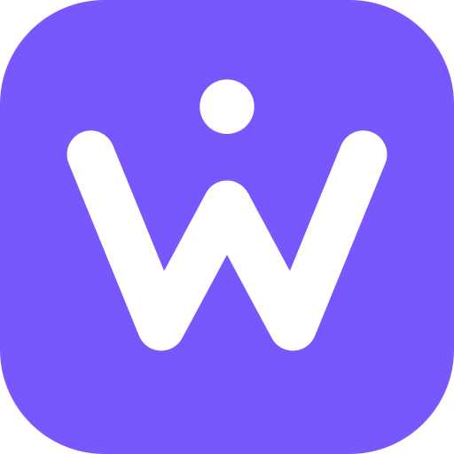
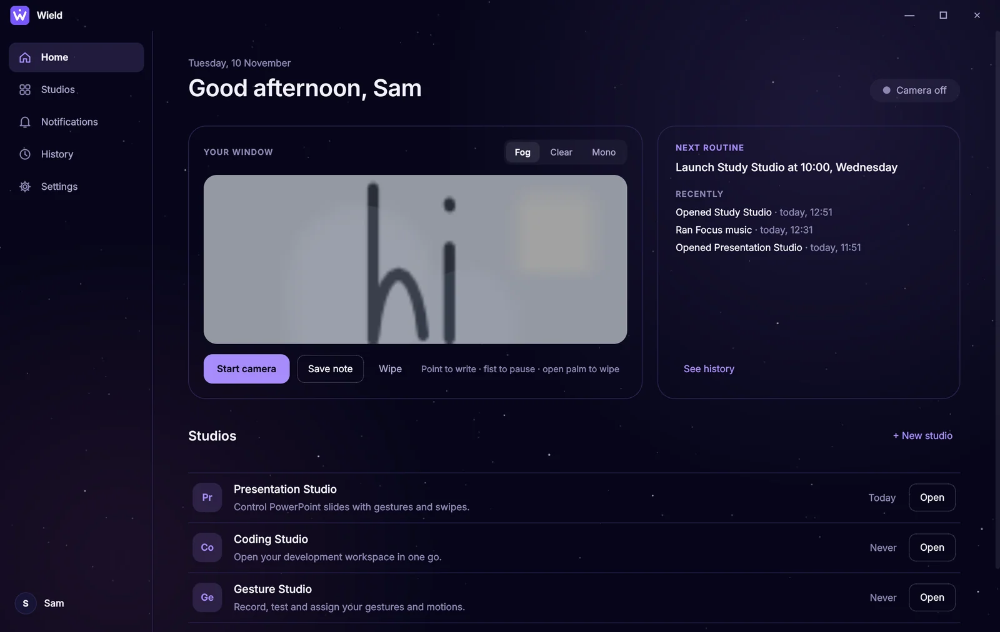
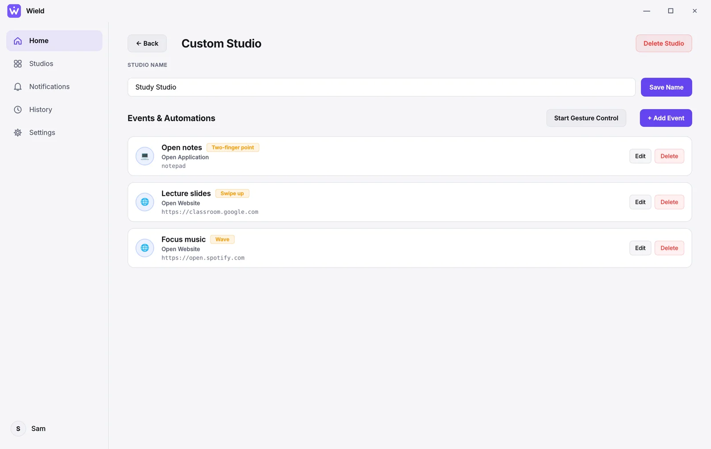
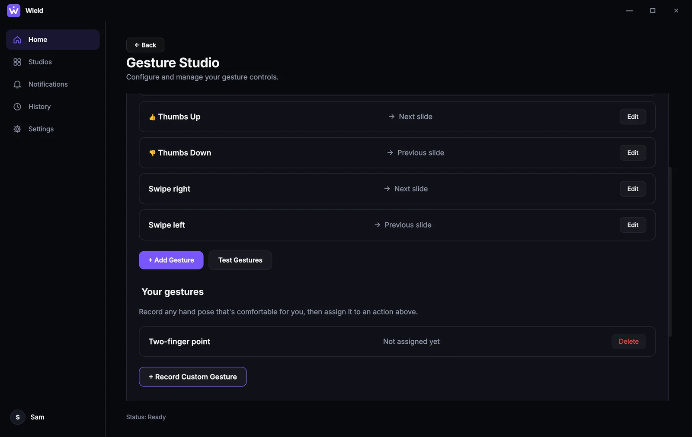
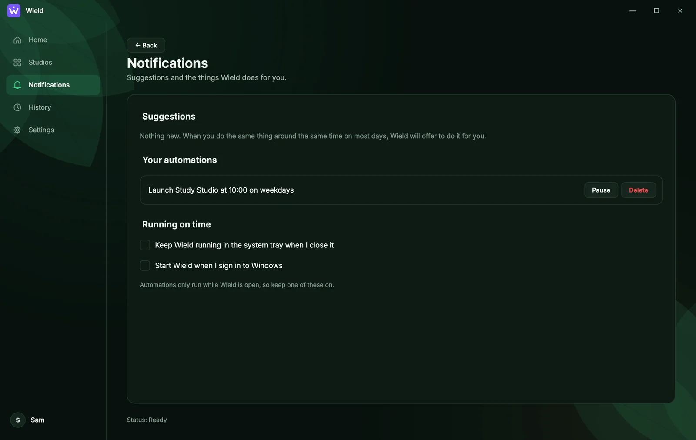
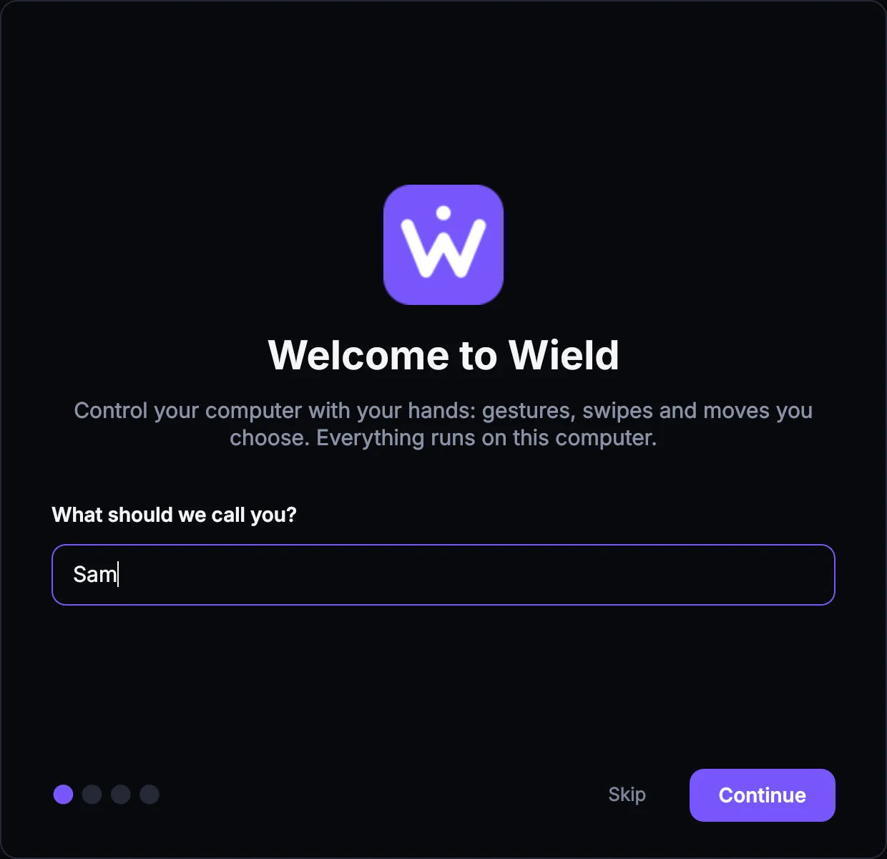

<p align="center">
  
</p>

<h1 align="center">Wield</h1>

<p align="center">
  <b>Control your computer with your hands.</b><br>
  Gestures, swipes and moves you choose. A free Windows app that runs entirely on your computer.
</p>

<p align="center">
  <a href="https://praveena-kiran.github.io/Wield/"><b>Website</b></a> ·
  <a href="https://github.com/Praveena-Kiran/Wield/releases/latest/download/Wield-windows.zip"><b>Download for Windows</b></a> ·
  <a href="#how-it-works">How it works</a>
</p>

<p align="center">
  <a href="https://github.com/Praveena-Kiran/Wield/actions/workflows/build.yml"></a>
  
  
</p>

<p align="center">
  
</p>

Wield turns an ordinary webcam into a remote control. Make a gesture, swipe the
air or teach it a movement of your own, and Wield opens apps and websites,
presses shortcuts, changes PowerPoint slides and runs your daily routines.

It is built for accessibility first. You don't have to make particular hand
shapes: record any pose or movement that is comfortable for you, and tune how
strict, slow or deliberate recognition should be.

## Features

- **Your own gestures.** Six gestures work out of the box (thumbs up and down, open palm, fist, peace, pointing). Record any other pose in three short takes.
- **Swipes and moves.** Swipe left, right, up or down, or record your own movements such as a wave or a circle. Movements you draw with a finger (like a "0") are tracked from your fingertip.
- **Voice commands.** Say "Hey Wield, next slide". Speech is recognised offline on your computer (a one-time 40 MB download in Settings); no audio is recorded or sent anywhere. Mix gestures, motions and voice freely: any of an action's triggers works.
- **Feedback you can hear and see.** A soft chime when Wield starts listening and when it runs an action, and a small note on top of full-screen slideshows ("👍 → Next slide"). Both can be turned off.
- **Studios.** Group actions for a task. Each event opens an app, file or website, presses a hotkey, controls PowerPoint or runs a flow, triggered by a click or a gesture.
- **Routine learning.** Wield notices what you do around the same time on most days and offers to automate it. Nothing runs until you say yes.
- **Accessibility settings.** Strict-to-forgiving sensitivity, hold-to-trigger, and an activation gesture so ordinary hand movement never triggers anything.
- **Gesture tester.** See live what Wield recognises and what it would do, without running anything.
- **Your window.** Home shows the camera through a foggy pane you can write on with your fingertip, and your note is still there next time.
- **Themes.** Dark, Light, Jungle and Galaxy, all checked against WCAG AA contrast.
- **Private.** Video is processed on your computer and never recorded or uploaded.

| Studios | Gesture Studio |
|---|---|
|  |  |
| **Notifications** | **First-run welcome** |
|  |  |

## Download

Get **[Wield-windows.zip](https://github.com/Praveena-Kiran/Wield/releases/latest/download/Wield-windows.zip)**
from the [latest release](https://github.com/Praveena-Kiran/Wield/releases/latest), extract it and run
`Wield\Wield.exe`. No Python or installer needed. Requires Windows 10 or 11 and a webcam.

> **"Windows protected your PC"?** Wield isn't code-signed yet, so Windows SmartScreen warns about it.
> Click **More info → Run anyway**. Every release is built and tested by GitHub Actions from this repository.

## How it works

1. **Seeing the hand.** Each camera frame goes through Google's MediaPipe hand landmarker,
   which returns 21 points per hand (wrist, knuckles and fingertips) plus its built-in
   gesture guess. Frames are paced at about 10 per second while no hand is visible and up
   to 24 when one is, which halves idle CPU use.
2. **Recognising poses** (`backend/gestures/custom_gestures.py`). Landmarks are normalised:
   moved so the wrist is the origin, scaled by palm length, and left hands mirrored onto
   right. A live pose matches a recorded one by nearest neighbour, but only if it is within
   a distance limit *and* clearly closer than any other gesture (an ambiguity margin). The
   thresholds were calibrated on real hand images. Recordings that look like a built-in
   gesture are rejected so the two never clash.
3. **Following motions** (`backend/gestures/motions.py`). The palm path is cut into strokes
   by speed, normalised to start at the origin with unit length, and resampled to 32
   evenly spaced points. User motions are matched with **dynamic time warping**. Built-in
   swipes use a straightness and direction rule instead, because plain DTW scored a
   20°-tilted swipe and an L-shape almost the same. The return movement after a swipe is
   ignored, so it doesn't trigger the opposite swipe.
4. **Triggering once.** A stabiliser fires a gesture once until the hand relaxes, with
   optional hold time. Matches become **events** (`backend/automation/events.py`), one
   model shared by every studio, run by `FlowManager`.
5. **Learning routines** (`backend/routines.py`). Activity is logged locally. If the same
   action happened within ±20 minutes of its typical time on at least 4 of the last 7 days
   Wield was used, it's suggested as a routine. Days without Wield don't break a habit, and
   weekday-only habits become weekday routines.

### Project layout

```
main.py                     window, navigation, gesture worker and routine scheduler
backend/
  gestures/                 recogniser, custom poses, motions, stabiliser, frame pacing
  automation/               events, flows, app launcher, PowerPoint control
  routines.py               activity log, routine detection and scheduling
  settings/                 settings, accessibility thresholds, user name
  paths.py, app_log.py      per-user data folder, log file
frontend/
  pages/                    Home, studios, Gesture Studio, Settings, Notifications, History
  components/               sidebar, foggy window, recorders, tester, welcome, dialogs
  styles/theme.py           the four themes
tests/                      unit tests (no camera needed)
website/                    the project website (GitHub Pages)
```

## Run from source

Requires Python 3.10+ and a webcam. Windows is needed for PowerPoint control and
start-at-sign-in; the rest also runs on macOS and Linux.

```bash
git clone https://github.com/Praveena-Kiran/Wield.git
cd Wield
python -m venv .venv
.venv\Scripts\activate
pip install -r requirements.txt
python main.py
```

Your studios, settings and recordings are stored in `%APPDATA%\Wield`
(`~/.config/wield` on Linux), so they survive updates. Settings → About has the
log file and a "Report a problem" button.

### Tests

```bash
python -m unittest discover tests
```

The unit tests cover pose normalisation and matching, motions and DTW, the
stabiliser, events and flows, the app launcher, routine detection, settings and
theme contrast. Camera hardware checks: `python -m tools.webcam_gesture_check`.

### Building the Windows app

GitHub Actions (`.github/workflows/build.yml`) runs the tests on every push and,
for pull requests and version tags, builds `Wield.exe` with PyInstaller and runs
`Wield.exe --self-test` on Windows. Pushing a tag publishes a release:

```bash
git tag v1.0.0
git push origin v1.0.0
```

To build locally:

```bash
pip install -r requirements.txt pyinstaller
pyinstaller Wield.spec --noconfirm
dist\Wield\Wield.exe --self-test
```

The website in `website/` is published by `.github/workflows/pages.yml`.

## Built with

Python · PySide6 (Qt) · MediaPipe · OpenCV · NumPy · PyInstaller · GitHub Actions

## License

MIT. See [LICENSE](LICENSE).

Made by [Praveena Kiran](https://github.com/Praveena-Kiran).
